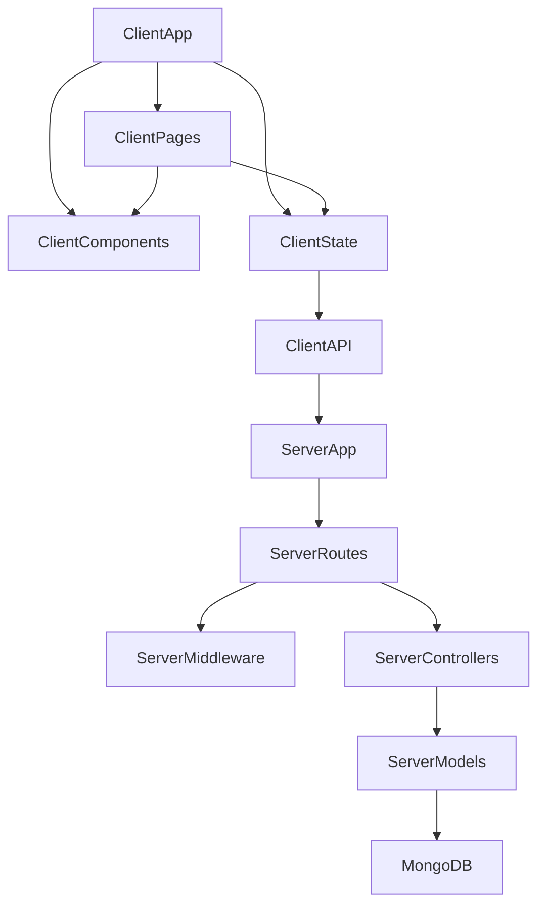

# CodeAlpha_ECommerceStore — Architecture

## 1. Stack
- Frontend: React 19 (Vite), React Router 7, Tailwind CSS, axios (client/package.json)
- Backend: Node.js (ESM) + Express 4, Mongoose 8, JWT (jsonwebtoken) + bcryptjs (server/package.json)
- Database: MongoDB, run locally via `docker-compose.yml`
- Dev tooling: nodemon (server), oxlint (client), Vite dev/build (client)

## 2. Directory map
| path | what lives there |
|---|---|
| client/ | React SPA root — Vite config, index.html, Tailwind/postcss config |
| client/src/ | app source (entry: main.jsx, App.jsx) |
| client/src/api/ | axios clients — authApi.js, ordersApi.js, productsApi.js, axiosClient.js |
| client/src/components/ | UI components — cart/, layout/, orders/, product/, ui/ |
| client/src/context/ | React context providers — AuthContext.jsx, CartContext.jsx |
| client/src/hooks/ | custom hooks — useAuth.js, useCart.js, useDebounce.js |
| client/src/pages/ | route-level pages — Home, ProductDetail, Cart, Checkout, Auth, OrderHistory, NotFound |
| client/src/utils/ | client helpers — formatCurrency.js, placeholderImage.js, validators.js |
| server/ | Express API — entry (server.js, app.js), .env.example |
| server/config/ | db.js — MongoDB connection setup |
| server/controllers/ | route handler logic (auth, order, product) |
| server/data/ | products.seed.js — seed data |
| server/middleware/ | authGuard.js, errorHandler.js, notFound.js |
| server/models/ | Mongoose schemas — Order.js, Product.js, User.js |
| server/routes/ | Express route definitions (auth, product, order) |
| server/utils/ | asyncHandler.js, generateToken.js |

## 3. Diagram

## 4. Component index
- [[ClientApp]]
- [[ClientPages]]
- [[ClientComponents]]
- [[ClientState]]
- [[ClientAPI]]
- [[ServerApp]]
- [[ServerRoutes]]
- [[ServerMiddleware]]
- [[ServerControllers]]
- [[ServerModels]]
- [[MongoDB]]

## 5. Entry points
- Dev client: `npm run dev` in client/ (Vite) → client/index.html → client/src/main.jsx → client/src/App.jsx. Runs on http://localhost:5173 (README.md)
- Dev server: `npm run dev` in server/ (nodemon) → server/server.js → server/app.js. Runs on http://localhost:5001 (README.md, server/server.js)
- Prod server: `npm start` in server/ → `node server.js` (server/package.json)
- Prod client build: `npm run build` in client/ → `vite build` (client/package.json)

## 6. Conventions
- Both packages use ES modules: `"type": "module"` in client/package.json and server/package.json; all read files use `import`/`export`.
- server/server.js imports `dotenv/config` as the very first import — code comment explains this is required so `process.env` is populated before app.js reads env vars at module-evaluation time.
- Express app is defined separately from the server bootstrap: server/app.js exports the configured `app`, server/server.js handles DB connect + listen + graceful shutdown (SIGINT/SIGTERM).
- CORS origin is read from `process.env.CLIENT_URL` (falls back to http://localhost:5173) rather than hardcoded (server/app.js comment).
- Request logging (`morgan('dev')`) is skipped when `NODE_ENV === 'test'` (server/app.js).
- Client routes are centralized in client/src/App.jsx via `<Routes>`; auth-gated routes (`/checkout`, `/orders`) are wrapped in a `ProtectedRoute` component.
- Client global state (Auth, Cart) is provided via Context, wired at the root in client/src/main.jsx (`AuthProvider` > `CartProvider` > `App`).
- Page components are named `*Page.jsx` under client/src/pages/.

## 7. Where things go
- New API resource: add schema to server/models/, handler to server/controllers/, route file to server/routes/, then register it in server/app.js.
- New client page: add component to client/src/pages/, add a `<Route>` in client/src/App.jsx, add a nav entry in client/src/components/layout/.
- New client API call: add a function to the relevant file in client/src/api/ (or a new file), consumed from context/hooks.
- New shared UI element: add to client/src/components/ui/.
- New global client state: add a provider under client/src/context/, wrap it in client/src/main.jsx, expose access via a hook in client/src/hooks/.
